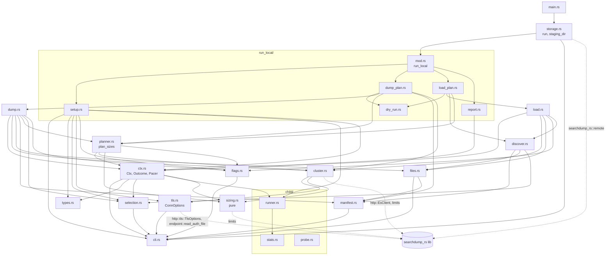
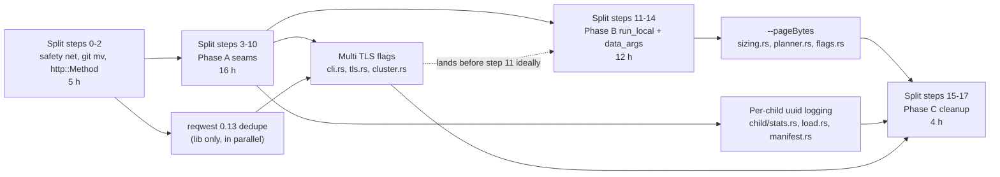

# Splitting `src/bin/searchdump-multi.rs` — design and migration plan

| | |
|---|---|
| Repo / base | `robertgoley/searchdump-rs`, `origin/main` @ `f6f8358` (Version 1.3.0), read-only clone at `/workspace/split-plan` (detached) |
| Requested by | Robert, t251u: "detailed markup for how the searchdump-multi.rs split would be done" |
| Status | **Design only**. No code, commits or pushes were made. |
| Target branch | `release/1.4` (once it is created from 1.3.1). The 1.3.1 patch doesn't touch this file, so the line numbers below should still hold there. |
| Headline fit | 1.4 = limits and multi polish. This split is review item **C19**, "do this first, before feature work" (REVIEW-1.4). |

## 0. Summary

* **Today:** one 4,515-line binary crate root. It has 3,457 lines of code plus a 1,059-line `mod tests` with 26 tests. There are 97 top-level items in 7 informal `// ---- section` blocks. `run_local` alone is 507 lines, and it mixes validation, type resolution, child-flag building, signal handling, the whole dump branch, the whole load branch and reporting.
* **Proposal:** turn the binary into a **directory binary**, `src/bin/searchdump-multi/main.rs` plus 17 top-level modules (25 files including the `child/` and `run_local/` submodules; tree in §2). The binary name stays the same, so `CARGO_BIN_EXE_searchdump-multi`, `target/*/searchdump-multi`, release tarballs, images and symlinks are unchanged. Nothing is added to the `searchdump_rs` library API. Tests move with the code they test.
* **Order:** **18 small behaviour-preserving commits** in three phases, about **37 engineer-hours (about 5 days)**, plus matrix wall time.
  * **Phase A (steps 0–10, about 21 h)** creates the seams the 1.4 features need: `cli`, `sizing`, `tls`/`ConnOptions`, `cluster`, `child`, `planner`, `dump`, `load`.
  * **Phase B (steps 11–14, about 12 h)** decomposes `run_local` and adds a shared child-argument builder.
  * **Phase C (steps 15–17, about 4 h)** tightens visibility and updates docs.
* **Against 1.4:**
  * The reqwest 0.13 dedupe can start right after step 2. Multi then has no direct `reqwest` use.
  * Multi TLS flags go after step 7 (the `tls.rs`/`ConnOptions` seam). Merging the reqwest dedupe first is better.
  * Per-child uuid logging goes after steps 8 and 10 (`child/`, `load.rs`).
  * `--pageBytes` goes after step 14 (shared child data-arg builder).

---

## 1. Inventory of the current file

The data was produced by `scratch/inventory.py`: a brace-matching scan of top-level items, with references matched by identifier. False positives from field names and `self.runner.run` were removed by hand. Line ranges include doc comments and attributes. "Callers" and "Callees" cover in-file items only. The **Target** column is the destination module from §2.

### 1.1 Section map (as the file is organised today)

| Lines | Section marker | Contents | Lines of code |
|---|---|---|---|
| 1–45 | crate docs, `#![forbid(unsafe_code)]`, `use` | – | 45 |
| 47–676 | (none) CLI and sizing | enums, `DATA_FLAGS`, `pub mod sizing`, flag merging, type constants, `Args` | 630 |
| 677–1062 | `selection` | `Selector`, targets, names, file naming, `Types` | 386 |
| 1063–1141 | `manifest` | `IndexEntry`, `ClusterEntry`, `Manifest` | 79 |
| 1142–1310 | `discovery (load)` | `Found`, `discover`, `is_part` | 169 |
| 1311–1356 | `data files` | `count_records`, `mappings_body` | 46 |
| 1357–1748 | `cluster` | `split_url`, parent retry policy, `Cluster` (14 methods) | 392 |
| 1749–2076 | `child runs` | `ChildStats`, stats parsing, binary probes, `Runner`, signals, `find_bin` | 328 |
| 2077–3456 | `dump / load` | `Outcome`, `Ctx`, `plan_sizes`, `Pacer`, `dump_one`, `dump_cluster`, `load_cluster`, `load_one`, `meta_dir`, `run`, `staging_dir`, **`run_local`**, `main` | 1,380 |
| 3457–4515 | `#[cfg(test)] mod tests` | 26 tests plus the `script_runner` helper | 1,059 |

### 1.2 Every top-level item

| Lines | Size | Item | Responsibility | Callers (in file) | Callees (in file) | Target |
|---|---|---|---|---|---|---|
| 47–47 | 1 | `pub const MANIFEST` | Manifest file name `multielasticdump.json` | impl Manifest, meta_dir, parse_data_file | – | `manifest.rs` |
| 49–56 | 8 | `pub enum Direction` | clap enum dump/load/copy | Args, meta_dir, run, run_local | – | `cli.rs` |
| 58–67 | 10 | `pub enum Layout` | clap+serde enum flat/index/group (dir layout) | Args, Manifest, dump_one, rel_dir, run_local | – | `cli.rs` |
| 69–76 | 8 | `pub enum Compression` | clap+serde enum gzip/zstd1/zstd3/none | Args, Manifest, count_records, data_parts, dump_one, impl Compression, load_one, node_item_file, parse_data_file, run_local | – | `cli.rs` |
| 78–106 | 29 | `impl Compression` | `suffix()` file extension, `flags()` child codec flags, `of_file()` codec from name | – | Compression | `cli.rs` |
| 108–115 | 8 | `pub enum Lifecycle` | clap enum drop/convert (ILM handling on load) | Args, cluster_flags, load_one | – | `cli.rs` |
| 117–125 | 9 | `const DATA_FLAGS` | Default child run-control flags (scrollTime, retries, timeout) | run_local | – | `flags.rs` |
| 127–367 | 241 | `pub mod sizing` | 1.2 server-aware sizing: `Plan::{new,dump,load,flags,line}`, `IndexSize`, `Stats`, `page_limit_for`, `page_estimate`, OFF_* consts (pure, no I/O) | Ctx, dump_one, impl Cluster, impl Ctx, note_size, plan_sizes | – | `sizing.rs` |
| 369–375 | 7 | `fn flag_name` | `--x=y`/`--x` -> `--x` | merge_data_flags, plan_sizes, sizing_json | – | `flags.rs` |
| 377–389 | 13 | `fn merge_data_flags` | Defaults overridden by user flags after `--` | merge_data_flags_owned, run_local | flag_name | `flags.rs` |
| 391–396 | 6 | `fn merge_data_flags_owned` | Owned-slice wrapper of the above | dump_one, load_one | merge_data_flags | `flags.rs` |
| 398–427 | 30 | `fn note_size` | Per-index stderr note when sizing shrinks a page | dump_one | limits_max_page, sizing | `planner.rs` |
| 429–431 | 3 | `fn limits_max_page` | Indirection to `limits::MULTI_MAX_PAGE` | note_size | – | `planner.rs` |
| 433–441 | 9 | `fn sizing_json` | Manifest per-index `sizing` object | dump_one | flag_name | `planner.rs` |
| 443–444 | 2 | `pub const TYPE_ORDER` | Per-index item order settings..data | resolve_types | – | `types.rs` |
| 446–455 | 10 | `pub const CLUSTER_TYPES` | Cluster-scoped item order | resolve_types, run_local | – | `types.rs` |
| 457–459 | 3 | `pub const CLUSTER_DIR` | `_cluster` subdirectory name | discover, dump_cluster, load_cluster, meta_dir, run_local | – | `files.rs` |
| 461–465 | 5 | `pub enum Order` | clap enum asc/desc | Args, run_local | – | `cli.rs` |
| 467–475 | 9 | `pub enum MatchType` | clap enum index/alias/datastream | Args, run_local, select_targets | – | `cli.rs` |
| 498–662 | 165 | `pub struct Args` | The whole clap CLI (~50 flags, after_help examples) | Ctx, impl Cluster, main | Compression, Direction, Layout, Lifecycle, MatchType, Order | `cli.rs` |
| 664–675 | 12 | `impl Args` | `splits()`: --fileSize/--maxRows given (also after `--`) | – | – | `cli.rs` |
| 679–684 | 6 | `pub struct Selector` | Compiled --match/--exclude/--includeHidden | Ctx, run_local, select_targets | – | `selection.rs` |
| 686–720 | 35 | `impl Selector` | `new`, `selects`, `has_group`, `group` (named capture -> dir) | – | sanitize_dir | `selection.rs` |
| 722–727 | 6 | `pub enum TargetKind` | Index | DataStream | Target, dump_one, run_local, select_targets | – | `selection.rs` |
| 729–737 | 9 | `pub struct Target` | Selected unit: name, matched (alias), kind | dump_one, select_targets | TargetKind | `selection.rs` |
| 739–785 | 47 | `pub fn select_targets` | Index/alias/data-stream selection -> Vec<Target> | run_local | MatchType, Selector, Target, TargetKind | `selection.rs` |
| 787–804 | 18 | `pub fn sanitize_dir` | Safe directory component from a group capture | impl Selector, rel_dir | – | `selection.rs` |
| 806–817 | 12 | `pub fn check_index_name` | Reject index names that would escape the dir | discover, load_one, run_local | – | `selection.rs` |
| 819–829 | 11 | `pub fn rel_dir` | Relative output dir for an index per layout | dump_one, run_local | Layout, sanitize_dir | `selection.rs` |
| 831–837 | 7 | `pub fn item_file` | `INDEX.KIND.json[.gz|.zst]` (oslogs.py naming) | dump_one, item_file_for, load_one | – | `files.rs` |
| 839–852 | 14 | `pub fn node_item_file` | Node multielasticdump 6.x naming | dump_one, item_file_for, run_local | Compression | `files.rs` |
| 854–861 | 8 | `pub fn item_file_for` | Picks item_file / node_item_file | dump_one, run_local | item_file, node_item_file | `files.rs` |
| 863–873 | 11 | `const META_SUFFIXES` | Non-data suffixes for parse_data_file | parse_data_file | – | `files.rs` |
| 875–910 | 36 | `pub fn parse_data_file` | Parse data/part file name -> (index, codec, part) | count_records, data_parts, discover, is_part, load_one, remove_data_files | Compression, MANIFEST, META_SUFFIXES | `files.rs` |
| 912–915 | 4 | `fn rs_named` | Is a file name in searchdump naming | discover | – | `files.rs` |
| 917–924 | 8 | `pub fn meta_file` | Find settings/mapping/alias file (either naming) | load_one, run_local | nonempty | `files.rs` |
| 926–937 | 12 | `fn read_text` | Read a meta file, decompress .gz | load_one | – | `files.rs` |
| 939–974 | 36 | `pub fn data_parts` | Ordered split parts of an index | discover, dump_one, run_local | Compression, file_name, parse_data_file | `files.rs` |
| 976–981 | 6 | `pub struct Types` | Resolved per-index and cluster type lists | Ctx, resolve_types | – | `types.rs` |
| 983–1034 | 52 | `pub fn node_type_flags` | Node `--ignoreX`/`--includeType` -> want/ignore lists | run_local | – | `types.rs` |
| 1036–1061 | 26 | `pub fn resolve_types` | Validate and order --types/--ignoreType | run_local | CLUSTER_TYPES, TYPE_ORDER, Types | `types.rs` |
| 1065–1090 | 26 | `pub struct IndexEntry` | Manifest per-index record (serde) | Manifest, dump_one | – | `manifest.rs` |
| 1092–1099 | 8 | `pub struct ClusterEntry` | Manifest per-cluster-type record (serde) | Manifest, dump_cluster | – | `manifest.rs` |
| 1101–1120 | 20 | `pub struct Manifest` | Manifest root (serde) | discover, dump_cluster, dump_one, impl Manifest, load_cluster, run_local | ClusterEntry, Compression, IndexEntry, Layout | `manifest.rs` |
| 1122–1140 | 19 | `impl Manifest` | `load`, `save` (atomic write) | – | MANIFEST, Manifest | `manifest.rs` |
| 1144–1153 | 10 | `pub struct Found` | An index found in a dump directory (load side) | discover, run_local | – | `discover.rs` |
| 1155–1304 | 150 | `pub fn discover` | Find indices in a dump dir from manifest or file scan (2 levels, both namings) | run_local | CLUSTER_DIR, Found, Manifest, check_index_name, data_parts, file_name, is_part, parse_data_file, rs_named | `discover.rs` |
| 1306–1309 | 4 | `fn is_part` | Is a path a split part | discover | file_name, parse_data_file | `files.rs` |
| 1313–1338 | 26 | `pub fn count_records` | Count lines in a data file (gzip/zstd aware) | dump_one, load_one | Compression, file_name, parse_data_file | `files.rs` |
| 1340–1355 | 16 | `pub fn mappings_body` | Normalise elasticdump mapping JSON for PUT _mapping | load_one | – | `files.rs` |
| 1359–1401 | 43 | `pub fn split_url` | Strip credentials from URL; auth-file > userinfo > env order | impl Cluster | – | `cluster.rs` |
| 1403–1408 | 6 | `pub const PARENT_429_RETRIES` | Parent retry count for read-only 429/503 | impl Cluster | – | `cluster.rs` |
| 1410–1417 | 8 | `pub fn parent_call_retryable` | Which parent calls may be retried | impl Cluster | – | `cluster.rs` |
| 1419–1422 | 4 | `pub fn parent_retry_delay` | Parent back-off 0.25 s..4 s | impl Cluster | – | `cluster.rs` |
| 1424–1428 | 5 | `pub struct Cluster` | Parent-side cluster handle (EsClient + child base URL) | dump_cluster, dump_one, plan_sizes, run_local | – | `cluster.rs` |
| 1430–1747 | 318 | `impl Cluster` | `new` (builds ClientOptions/TlsOptions: only `--insecure` today), `call`/`ok_json` (429 retry), list_indices/aliases/data_streams, data_stream, exists, count, index_stats, target_stats, probe_limits, put_mapping, index_url | – | Args, PARENT_429_RETRIES, parent_call_retryable, parent_retry_delay, sizing, split_url | `cluster.rs` |
| 1751–1758 | 8 | `pub enum CountSource` | StatsFile | LogLine | ChildStats, parse_stats_file, parse_total_writes | – | `child/stats.rs` |
| 1760–1767 | 8 | `pub struct ChildStats` | written/failed/source from a child run | dump_one, impl Runner, parse_stats_file, parse_total_writes | CountSource | `child/stats.rs` |
| 1769–1775 | 7 | `impl ChildStats` | `docs_read()` | – | – | `child/stats.rs` |
| 1777–1788 | 12 | `pub fn parse_stats_file` | Parse child `--statsFile` JSON | child_stats | ChildStats, CountSource | `child/stats.rs` |
| 1790–1817 | 28 | `pub fn parse_total_writes` | Fallback: parse "Total Writes:" from child log | child_stats | ChildStats, CountSource | `child/stats.rs` |
| 1819–1828 | 10 | `fn read_tail` | Read last N bytes of a file | child_stats | – | `child/stats.rs` |
| 1830–1841 | 12 | `pub fn child_stats` | Stats file, else log tail | impl Runner | parse_stats_file, parse_total_writes, read_tail | `child/stats.rs` |
| 1843–1851 | 9 | `pub fn takes_stats_file` | Is the child binary searchdump (by resolved name) | run_local | file_name | `child/probe.rs` |
| 1853–1866 | 14 | `fn accepts_server_limits` | Probe: child accepts --serverLimits | run_local | – | `child/probe.rs` |
| 1868–1877 | 10 | `fn accepts_stats_file` | Probe: child accepts --statsFile | run_local | – | `child/probe.rs` |
| 1879–1882 | 4 | `fn debug_counts` | SEARCHDUMP_MULTI_DEBUG switch | dump_one | – | `dump.rs` |
| 1884–1885 | 2 | `pub const CHILD_GRACE` | SIGTERM->SIGKILL grace (5 s) | run_local | – | `child/runner.rs` |
| 1887–1903 | 17 | `pub struct Runner` | Child process launcher config (bin, log dir, common/data flags, cancel) | Ctx, run_local | – | `child/runner.rs` |
| 1905–2000 | 96 | `impl Runner` | `run`, `run_as`: spawn child in own pgid, log to file, cancel/SIGTERM, return ChildStats | – | ChildStats, Runner::run, child_stats, stop_child, tail | `child/runner.rs` |
| 2002–2022 | 21 | `async fn stop_child` | SIGTERM then SIGKILL after grace | impl Runner | send_term | `child/runner.rs` |
| 2024–2040 | 17 | `async fn send_term` | `kill -TERM` (no unsafe) | stop_child | – | `child/runner.rs` |
| 2042–2052 | 11 | `fn tail` | Last n log lines for error messages | impl Runner | – | `child/runner.rs` |
| 2054–2069 | 16 | `fn find_bin` | Locate the searchdump binary | run_local | – | `child/probe.rs` |
| 2071–2075 | 5 | `fn nonempty` | File exists and len>0 | dump_one, load_cluster, meta_file, run_local | – | `files.rs` |
| 2079–2084 | 6 | `pub enum Outcome` | Done/Skipped/Failed per unit | dump_cluster, dump_one, load_cluster, load_one, run_local | – | `ctx.rs` |
| 2086–2099 | 14 | `struct Ctx` | Shared run state (args, meta dir, types, selector, runner, pacer, plan, stats) | dump_cluster, dump_one, plan_sizes, run_local | Args, Pacer, Runner, Selector, Types, sizing | `ctx.rs` |
| 2101–2117 | 17 | `impl Ctx` | `plan()` (default Off plan), `stats_of()` | – | sizing | `ctx.rs` |
| 2119–2231 | 113 | `async fn plan_sizes` | Probe limits + one stats call, build Plan, `--serverLimits=check` output and stop code, manifest server_limits JSON | run_local | Cluster, Ctx, flag_name, sizing | `planner.rs` |
| 2233–2237 | 5 | `pub struct Pacer` | --interval start spacing | Ctx, run_local | – | `ctx.rs` |
| 2239–2257 | 19 | `impl Pacer` | `new`, `wait` | – | – | `ctx.rs` |
| 2259–2260 | 2 | `const LIFECYCLE_DROP` | excludeSettings flag for --lifecycle drop | cluster_flags, load_one | – | `flags.rs` |
| 2262–2264 | 3 | `fn strings` | &[&str] -> Vec<String> | dump_one, load_one | – | `flags.rs` |
| 2266–2282 | 17 | `fn remove_data_files` | Delete an index's previous data files/parts | dump_one | file_name, parse_data_file | `files.rs` |
| 2284–2288 | 5 | `fn file_name` | Path -> file name string | count_records, data_parts, discover, dump_one, is_part, load_one, remove_data_files, takes_stats_file | – | `files.rs` |
| 2290–2474 | 185 | `async fn dump_one` | Dump one index/data stream: kinds loop, child runs, record counting/verification, manifest entry | run_local | ChildStats, Cluster, Compression, Ctx, IndexEntry, Layout, Manifest, Outcome, Runner::run, Target, TargetKind, count_records, data_parts, debug_counts, file_name, item_file, item_file_for, merge_data_flags_owned, node_item_file, nonempty, note_size, rel_dir, remove_data_files, sizing, sizing_json, strings | `dump.rs` |
| 2476–2492 | 17 | `fn cluster_flags` | Flags for cluster-scoped load runs (lifecycle) | load_cluster, load_one | LIFECYCLE_DROP, Lifecycle | `flags.rs` |
| 2494–2534 | 41 | `async fn dump_cluster` | Dump cluster-scoped types to _cluster/ | run_local | CLUSTER_DIR, Cluster, ClusterEntry, Ctx, Manifest, Outcome, Runner::run | `dump.rs` |
| 2536–2576 | 41 | `async fn load_cluster` | Load _cluster/ files in order | run_local | CLUSTER_DIR, Manifest, Outcome, Runner::run, cluster_flags, nonempty | `load.rs` |
| 2578–2737 | 160 | `async fn load_one` | Load one index: exists/skip, template, settings/mapping/alias/data runs, parts, count verification | run_local | Compression, LIFECYCLE_DROP, Lifecycle, Outcome, Runner::run, check_index_name, cluster_flags, count_records, file_name, item_file, mappings_body, merge_data_flags_owned, meta_file, parse_data_file, read_text, strings, with_part | `load.rs` |
| 2739–2748 | 10 | `fn with_part` | Add part context to an error | load_one | – | `load.rs` |
| 2750–2774 | 25 | `pub fn meta_dir` | Where manifest and _cluster live (--metaDir / nodeCompat / detection) | run, run_local | CLUSTER_DIR, Direction, MANIFEST | `files.rs` |
| 2776–2904 | 129 | `async fn run` | Storage-URL dispatch (copy, dump via staging + upload, load via download), `--parallel` check | main | run_local, staging_dir, remote::{parse_dir,copy_tree,is_storage_url} | `storage.rs` |
| 2906–2924 | 19 | `fn staging_dir` | --stagingDir or temp dir (opendal only) | run | chrono_stamp | `storage.rs` |
| 2926–3432 | 507 | `async fn run_local` | Validation, type resolution, selector, log dir, child flags, Ctrl-C, Runner, Ctx, dump branch (select, dry-run, plan, manifest, resume, byte budget, spawn), load branch (discover, dry-run, plan, spawn), result reporting and exit code | run | CHILD_GRACE, CLUSTER_DIR, CLUSTER_TYPES, Cluster, Compression, Ctx, DATA_FLAGS, Direction, Found, Layout, Manifest, MatchType, Order, Outcome, Pacer, Runner, Selector, TargetKind, accepts_server_limits, accepts_stats_file, check_index_name, chrono_stamp, data_parts, discover, dump_cluster, dump_one, find_bin, item_file_for, load_cluster, load_one, merge_data_flags, meta_dir, meta_file, node_item_file, node_type_flags, nonempty, plan_sizes, rel_dir, resolve_types, select_targets, takes_stats_file | `run_local/* (orchestrate)` |
| 3434–3439 | 6 | `fn chrono_stamp` | Unix seconds for dir names | run_local, staging_dir | – | `storage.rs` |
| 3441–3455 | 15 | `fn main` | Parse args, build runtime, map Err -> exit 2 | – | Args, run | `main.rs` |

### 1.3 Methods inside `impl` blocks and `mod sizing`

| Owner | Methods (line) |
|---|---|
| `impl Compression` | `suffix`@79, `flags`@86 (private), `of_file`@95 |
| `mod sizing` | `page_limit_for`@146, `avg`@186 (private), `page_estimate`@191, `Plan::{new, dump, load, flags, line}`@200–366; types `Plan`@155, `IndexSize`@174, `Stats` (alias `(u64,u64)`) |
| `impl Args` | `splits`@666 |
| `impl Selector` | `new`@687, `selects`@700, `has_group`@710, `group`@715 |
| `impl Manifest` | `load`@1123, `save`@1134 |
| `impl Cluster` | `new`@1431 (**the only place the parent builds `ClientOptions`/`TlsOptions`; only `insecure` is set, and `ca/cert/key/pass` are `None`**), `index_url`@1466, `call`@1472 (private, 429/503 retry), `ok_json`@1502 (private), `list_indices`@1529, `list_aliases`@1567, `list_data_streams`@1591, `data_stream`@1620, `exists`@1643, `count`@1658, `index_stats`@1673, `target_stats`@1707, `probe_limits`@1725, `put_mapping`@1742 |
| `impl ChildStats` | `docs_read`@1772; nested fn `number_after`@1793 inside `parse_total_writes` |
| `impl Runner` | `run`@1907, `run_as`@1925 (spawn, own process group, log file, `--statsFile`, cancel, SIGTERM/SIGKILL, `child_stats`) |
| `impl Ctx` | `plan`@2102 (lazy default `Mode::Off` plan), `stats_of`@2114 |
| `impl Pacer` | `new`@2240, `wait`@2247 |

### 1.4 Tests and where they go

| Lines | Test | Exercises | Moves to |
|---|---|---|---|
| 3460 | `extra_flags_override_default_data_flags` | `merge_data_flags*`, `DATA_FLAGS`, `strings` | `flags.rs` |
| 3493 | `run_control_flags_unchanged` | `DATA_FLAGS` | `flags.rs` |
| 3509 | `parent_retries_only_read_only_calls_on_429_and_503` | `parent_call_retryable`, `parent_retry_delay` | `cluster.rs` |
| 3538 | `server_limits_off_reproduces_1_1_0_flags` | `sizing`, `merge_data_flags` | `sizing.rs` (imports `crate::flags`) |
| 3606 | `page_limit_shrinks_for_large_documents` | `sizing` | `sizing.rs` |
| 3621 | `auto_plan_sizes_from_fixture_limits` | `sizing` | `sizing.rs` |
| 3674 | `selection_include_exclude_hidden` | `Selector` | `selection.rs` |
| 3699 | `group_breakout` | `Selector`, `rel_dir`, `sanitize_dir` | `selection.rs` |
| 3731 | `names_and_types` | `check_index_name`, `item_file`, `resolve_types` | `types.rs` (or split into selection/files/types) |
| 3787 | `mappings_body_shapes` | `mappings_body` | `files.rs` |
| 3802 | `credentials_order_and_redaction` | `split_url` | `cluster.rs` |
| 3836 | `record_counts_all_codecs` | `count_records` | `files.rs` |
| 3856 | `discover_layouts_and_manifest` | `discover`, `Manifest` | `discover.rs` |
| 3916 | `targets_by_index_alias_and_datastream` | `select_targets`, `rel_dir` | `selection.rs` |
| 3976 | `split_part_names_and_discovery` | `parse_data_file`, `data_parts`, `discover`, `remove_data_files` | `discover.rs` |
| 4035 | `split_flag_detection_and_cluster_flags` | `Args::splits`, `cluster_flags` | `flags.rs` |
| 4088 | `interval_spaces_out_starts` (tokio) | `Pacer` | `ctx.rs` |
| 4113 | `node_ignore_flags` | `node_type_flags`, `resolve_types` | `types.rs` |
| 4178 | `node_names_and_meta_dir` | `meta_dir`, `node_item_file`, `meta_file`, `discover` | `files.rs` |
| 4263 | `script_runner` (helper) | builds `Runner` field by field | `child/runner.rs` (`#[cfg(test)] pub(crate)`) |
| 4286 | `cancel_stops_a_running_child_with_sigterm_then_sigkill` | `Runner::run_as`, `stop_child` | `child/runner.rs` |
| 4341 | `a_failed_load_step_names_its_part_only_when_there_are_several` | `with_part` | `load.rs` |
| 4356 | `a_failed_child_reports_its_log_tail` | `Runner`, `tail` | `child/runner.rs` |
| 4385 | `many_children_do_not_starve_the_runtime` | `Runner` | `child/runner.rs` |
| 4420 | `child_counts_from_stats_file_or_log_line` | `parse_stats_file`, `parse_total_writes`, `child_stats` | `child/stats.rs` |
| 4471 | `stats_file_only_for_searchdump` | `takes_stats_file` | `child/probe.rs` |
| 4495 | `runner_returns_child_counts` | `Runner`, `CountSource` | `child/runner.rs` |

Tests outside the file that exercise the binary:
* `tests/cli_contract.rs`: `l2_005_multi_parent_probes_once_and_reads_stats_in_one_call` (around line 5287, `CARGO_BIN_EXE_searchdump-multi`) and another spawn at around line 5253.
* `scripts/it/multielasticdump-roundtrip.sh`: a dump-then-load round trip against two in-memory `fake_es.py` nodes, with no containers.
* `scripts/test-image.sh`: the `searchdump-multi` and `multielasticdump` entrypoints in the images.
* The perf and load harnesses: `scripts/perf/*`, `scripts/load/*`.

No test in the repo names a unit test by its module path, and the flake policy and traceability files don't either. So test renames such as `tests::x` becoming `child::runner::tests::x` break nothing. Only docs mention `searchdump-multi.rs` by path: FEATURES-TODO (7 mentions), ROADMAP-1.1/1.2, `results/local/{L3-008,L-824,1.1-10}.md` and `examples/README.md`. Historical results stay as they are; FEATURES-TODO and `examples/README.md` get updated in step 17.

### 1.5 Hotspots

| Item | Lines | Why it's a problem |
|---|---|---|
| `run_local` | 507 | 11 responsibilities, 2 branches of about 190 lines each, 3 early-exit codes (0/1/stop-code) plus 130 and `?`→2. It can't be tested without a cluster. |
| `impl Cluster` | 318 | `new(&Args)` ties the HTTP layer to the CLI struct, and that's exactly where multi TLS has to go. |
| `sizing` | 241 | Already a clean inline module, so it's the cheapest win. `--pageBytes` lands here. |
| `dump_one` | 185 | Builds the child data args inline (codec, split, sizing, merge). `load_one` repeats the same pattern. |
| `load_one` | 160 | Same duplication of the data-arg build. |
| `discover` | 150 | Pure filesystem logic and well tested; it just needs to move. |
| `Args` | 165 | Flat clap struct. TLS adds 8–10 flags. |

---

## 2. Target module tree

### 2.1 Where the code lives: options

| Option | Layout | Pros | Cons | Verdict |
|---|---|---|---|---|
| **A. Directory binary** | `src/bin/searchdump-multi/main.rs` + `mod x;` siblings | Cargo autobins keeps the bin name. No lib API growth. `pub(crate)` means exactly "this binary". `#![forbid(unsafe_code)]` at the root covers all modules. | Unit tests still build as the bin test target (as today) | **Recommended** |
| B. Library module | `src/multi/…` as `#[doc(hidden)] pub mod multi` in `searchdump_rs`, thin `main.rs` | Integration tests could call the internals. Shares lib compile units. | Grows the published lib surface and semver obligations. Lib items have to be `pub`. The lib picks up clap derive for `Args` (it already has clap, but it's a second CLI in the lib). Feature cfgs leak into the lib. | Not now. Revisit if a second consumer appears (e.g. a `check-limits` subcommand, 1.3-A). |
| C. Hybrid | Pure parts (`sizing`, naming, manifest) in the lib, orchestration in the bin | Lets `searchdump` reuse sizing | Two homes for one feature. `sizing` already depends only on `searchdump_rs::limits`. | Defer. The REVIEW-1.4 item "move `server_limits` out of `lib.rs`" is the right moment to reconsider. |

### 2.2 Tree (approximate lines of code after the move, excluding tests)

```
src/bin/searchdump-multi/
├── main.rs            15 + docs   crate docs (//!), #![forbid(unsafe_code)], mod decls, fn main
├── cli.rs            ~255   Args (+splits), Direction, Layout, Compression(+impl), Lifecycle, Order, MatchType
├── flags.rs           ~60   DATA_FLAGS, LIFECYCLE_DROP, flag_name, merge_data_flags(_owned), strings, cluster_flags
├── tls.rs        new  ~60   ConnOptions (+ from_args), child_conn_flags(&Args): the parent/child TLS+auth seam
├── sizing.rs         ~240   the current `pub mod sizing` body, verbatim (pure)
├── planner.rs        ~155   plan_sizes, note_size, sizing_json, limits_max_page
├── types.rs           ~95   TYPE_ORDER, CLUSTER_TYPES, Types, node_type_flags, resolve_types
├── selection.rs      ~145   Selector, TargetKind, Target, select_targets, sanitize_dir, check_index_name, rel_dir
├── files.rs          ~240   CLUSTER_DIR, item_file*, META_SUFFIXES, parse_data_file, rs_named, meta_file, read_text,
│                            data_parts, is_part, count_records, mappings_body, remove_data_files, file_name, nonempty, meta_dir
├── manifest.rs        ~75   MANIFEST, IndexEntry, ClusterEntry, Manifest(load/save)
├── discover.rs       ~160   Found, discover
├── cluster.rs        ~385   split_url, PARENT_429_RETRIES, parent_call_retryable, parent_retry_delay, Cluster(+impl)
├── child/
│   ├── mod.rs          ~5   pub(crate) use re-exports
│   ├── stats.rs       ~85   CountSource, ChildStats, parse_stats_file, parse_total_writes, read_tail, child_stats
│   ├── runner.rs     ~165   CHILD_GRACE, Runner(run, run_as), stop_child, send_term, tail
│   └── probe.rs       ~50   find_bin, takes_stats_file, accepts_server_limits, accepts_stats_file
├── ctx.rs             ~60   Outcome, Ctx(+plan, stats_of, new), Pacer
├── dump.rs           ~230   dump_one, dump_cluster, debug_counts  (+ data_args from step 14)
├── load.rs           ~210   load_one, load_cluster, with_part
├── storage.rs        ~155   run (storage-URL dispatch), staging_dir, chrono_stamp
└── run_local/
    ├── mod.rs        ~110   run_local (orchestration only, see §4)
    ├── setup.rs      ~140   validate_local, run_types, selector, warn_url_credentials, log_dir, Interrupt, build_runner
    ├── dump_plan.rs  ~170   select_dump_targets, prepare_manifest, already_done, byte_budget, spawn_dumps
    ├── load_plan.rs   ~70   discover_selected, cluster_files_present, spawn_loads
    ├── dry_run.rs    ~100   print_dump_plan, print_load_plan
    └── report.rs      ~60   Tally (record, summary_line, exit_code), collect
```

That's 17 top-level modules (`cli`, `flags`, `tls`, `sizing`, `planner`, `types`, `selection`, `files`, `manifest`, `discover`, `cluster`, `child/`, `ctx`, `dump`, `load`, `storage`, `run_local/`), or 25 files plus `main.rs`. The largest after the split is `cluster.rs` at about 385 lines. No function is over about 110 lines once step 14 is done (`dump_one` is about 120 before it).

### 2.3 Function-level move table

All moves are verbatim apart from `use` lines, visibility, and the three marked seam changes (step 7: `Cluster::new` taking `ConnOptions`, `child_conn_flags`, `child_base()` accessor; steps 11–14: extractions).

| From (current line) | Item | To | Visibility after |
|---|---|---|---|
| 1–23 | crate `//!` docs, `#![forbid(unsafe_code)]` | `main.rs` | – |
| 47 | `MANIFEST` | `manifest.rs` | `pub(crate) const` |
| 49–115, 461–475 | `Direction`, `Layout`, `Compression`+impl, `Lifecycle`, `Order`, `MatchType` | `cli.rs` | `pub(crate)`; `Compression::flags` → `pub(crate)` (used by `dump.rs`) |
| 120 | `DATA_FLAGS` | `flags.rs` | `pub(crate)` |
| 131–367 | `mod sizing` body | `sizing.rs` (file module; drop the `pub mod sizing {}` wrapper) | items stay `pub` inside a `pub(crate) mod sizing` (or switch to `pub(crate)`); `avg` private |
| 370–396 | `flag_name`, `merge_data_flags`, `merge_data_flags_owned` | `flags.rs` | `pub(crate)` |
| 400–441 | `note_size`, `limits_max_page`, `sizing_json` | `planner.rs` | `note_size`, `sizing_json` `pub(crate)` (used by `dump.rs`); `limits_max_page` private |
| 444–459 | `TYPE_ORDER`, `CLUSTER_TYPES` | `types.rs` | `pub(crate)` |
| 459 | `CLUSTER_DIR` | `files.rs` | `pub(crate)` |
| 498–675 | `Args`, `impl Args` | `cli.rs` | `pub(crate) struct`, fields `pub(crate)` |
| 679–720 | `Selector`+impl | `selection.rs` | `pub(crate)`; fields private |
| 722–785 | `TargetKind`, `Target`, `select_targets` | `selection.rs` | `pub(crate)`; `Target` fields `pub(crate)` |
| 788–829 | `sanitize_dir`, `check_index_name`, `rel_dir` | `selection.rs` | `pub(crate)` (`sanitize_dir` could be private, but a test uses it, so `pub(super)` / test-visible) |
| 831–861 | `item_file`, `node_item_file`, `item_file_for` | `files.rs` | `pub(crate)` |
| 865–974 | `META_SUFFIXES`, `parse_data_file`, `rs_named`, `meta_file`, `read_text`, `data_parts` | `files.rs` | `rs_named`, `META_SUFFIXES` private; `read_text` `pub(crate)` (load) |
| 978–1061 | `Types`, `node_type_flags`, `resolve_types` | `types.rs` | `pub(crate)`; `Types` fields `pub(crate)` |
| 1066–1140 | `IndexEntry`, `ClusterEntry`, `Manifest`+impl | `manifest.rs` | `pub(crate)`; fields `pub(crate)` (serde derive is unaffected by visibility) |
| 1145–1309 | `Found`, `discover`, `is_part` | `discover.rs` (`is_part` → `files.rs`, private helper used by `discover` → `pub(crate)`) | `pub(crate)` |
| 1314–1355 | `count_records`, `mappings_body` | `files.rs` | `pub(crate)` |
| 1361–1747 | `split_url`, retry policy, `Cluster`+impl | `cluster.rs` | `pub(crate)`; `call`, `ok_json` private; **field `child_base` gets a `pub(crate) fn child_base(&self) -> &str`** (8 field reads in `dump_one`, `dump_cluster`, `load_cluster`, `load_one`) |
| 1431 | `Cluster::new(raw, env_prefix, &Args)` | `cluster.rs` → **`Cluster::new(raw, env_prefix, &ConnOptions)`** | seam (step 7) |
| 3012–3018 (in `run_local`) | `common` flag build (`--insecure`, `--httpAuthFile`) | `tls.rs::child_conn_flags(&Args)` | seam (step 7) |
| 1751–1841 | `CountSource`, `ChildStats`, `parse_stats_file`, `parse_total_writes`, `read_tail`, `child_stats` | `child/stats.rs` | `read_tail` private; rest `pub(crate)` |
| 1846–1877 | `takes_stats_file`, `accepts_server_limits`, `accepts_stats_file` | `child/probe.rs` | `pub(crate)` |
| 1880 | `debug_counts` | `dump.rs` | private |
| 1885–2052 | `CHILD_GRACE`, `Runner`+impl, `stop_child`, `send_term`, `tail` | `child/runner.rs` | `Runner` + fields `pub(crate)` (the test helper builds it); `stop_child`, `send_term`, `tail` private |
| 2054 | `find_bin` | `child/probe.rs` | `pub(crate)` |
| 2071 | `nonempty` | `files.rs` | `pub(crate)` |
| 2080–2117 | `Outcome`, `Ctx`+impl | `ctx.rs` | `pub(crate)`; `Ctx` fields `pub(crate)`; new `Ctx::new` in step 11 |
| 2123–2231 | `plan_sizes` | `planner.rs` | `pub(crate) async fn` |
| 2234–2257 | `Pacer`+impl | `ctx.rs` | `pub(crate)` |
| 2259–2264 | `LIFECYCLE_DROP`, `strings` | `flags.rs` | `pub(crate)` |
| 2269–2288 | `remove_data_files`, `file_name` | `files.rs` | `pub(crate)` |
| 2290–2474 | `dump_one` | `dump.rs` | `pub(crate) async fn` |
| 2477–2492 | `cluster_flags` | `flags.rs` | `pub(crate)` |
| 2495–2534 | `dump_cluster` | `dump.rs` | `pub(crate)` |
| 2537–2737 | `load_cluster`, `load_one` | `load.rs` | `pub(crate)` |
| 2742 | `with_part` | `load.rs` | private (test in same module) |
| 2753–2774 | `meta_dir` | `files.rs` | `pub(crate)` |
| 2779–2924 | `run`, `staging_dir` (`#[cfg(feature = "opendal")]` and the `cfg_attr` stay attached) | `storage.rs` | `pub(crate) async fn run` |
| 2926–3432 | `run_local` | `run_local/mod.rs`, then decomposed (§4) | `pub(crate) async fn` |
| 3434 | `chrono_stamp` | `storage.rs` | `pub(crate)` (also used by `run_local::setup::log_dir`) |
| 3441 | `main` | `main.rs` | – |

**Visibility rule.** Use the narrowest scope that compiles: private for a single module, `pub(super)` for siblings inside `child/` and `run_local/`, and `pub(crate)` across the binary. Today's bare `pub` is equivalent in a binary crate, but `pub(crate)` documents the intent and lets `unreachable_pub` be turned on in step 15. Imports use `crate::cli::Args` and so on; no glob re-exports except `child/mod.rs`.

---

## 3. Dependency graph after the split



**Layers, bottom to top:**
1. `cli`, `types`, `sizing`, `child/*`, `flags`: no in-crate dependencies, or `cli` only.
2. `selection`, `manifest`, `files`, `tls`.
3. `discover`, `cluster`.
4. `ctx`, `planner`.
5. `dump`, `load`.
6. `run_local/*`.
7. `storage`, then `main`.

Every edge points down a layer.

### 3.1 Cycles, and how they're avoided or broken

Rust allows cycles between modules in one crate, so none of these would fail to compile. They're avoided to keep the layers testable.

| # | Cycle that a naive split creates | Cause | Resolution |
|---|---|---|---|
| C1 | `cluster` ↔ `cli` (and, transitively, every feature that touches `Args`) | `Cluster::new(raw, prefix, &Args)` reads `args.http_auth_file` and `args.insecure` | **Step 5:** `Cluster::new(raw, prefix, &ConnOptions)`. `ConnOptions::from_args(&Args, Side)` lives in `tls.rs`. `cluster` then depends on `tls` only, and TLS flags are added in one place. |
| C2 | `sizing` ↔ `ctx` | If `plan_sizes` (which needs `Ctx` and `Cluster`) sits in `sizing.rs`, and `Ctx` holds `sizing::Plan` | Keep `sizing.rs` pure (today's inline module) and put `plan_sizes`/`note_size`/`sizing_json` in `planner.rs`. |
| C3 | `dump`/`load` ↔ `run_local` | If `Ctx` and `Outcome` stay next to `run_local` | `ctx.rs` holds `Ctx`, `Outcome` and `Pacer`. `run_local` only consumes them. |
| C4 | `files` ↔ `manifest` | If `discover` (uses `parse_data_file`, `data_parts`, `Manifest::load`) lives in `manifest.rs` while `files::meta_dir`/`parse_data_file` use `MANIFEST` | `discover.rs` is its own module. `files → manifest` (constant only) is the single direction. |
| C5 | `storage` ↔ `run_local` via `chrono_stamp` | Both use it | `chrono_stamp` lives in `storage.rs`, and `run_local::setup` imports it. That's one direction. A `util.rs` is the alternative if more helpers show up. |
| C6 | Intra-doc links | `Ctx::plan` docs link to ``[`plan_sizes`]``, `Runner::stats` links to ``[`takes_stats_file`]`` | Rewrite as ``[`crate::planner::plan_sizes`]`` etc. These are rustdoc links only, not code edges. Check with `cargo doc --bin searchdump-multi --no-deps`. |

---

## 4. Decomposing `run_local` (lines 2926–3432)

### 4.1 What it does today, in order

| Lines | Block | Exit behaviour |
|---|---|---|
| 2927–2950 | Validation: load with `--fileSize/--maxRows`; `--nodeCompat` rules (layout, codec, splits, datastream) | `bail!` → exit 2 |
| 2951–2989 | Default types per direction, `node_type_flags`, `resolve_types`, nodeCompat template shuffle and warnings | `?` → 2 |
| 2990–2993 | `Selector::new`, `--layout group` capture check | `bail!` → 2 |
| 2994–3003 | Password-in-URL warning | stderr |
| 3004–3011 | Log dir (`--logDir` or temp + pid + stamp) | – |
| 3012–3026 | Child `common` flags (`--insecure`, `--httpAuthFile`), `data_flags` merge | – |
| 3027–3042 | Ctrl-C task: `cancelled` flag and `CancellationToken` | later 130 |
| 3043–3068 | `find_bin`, probes, `Runner`, `Pacer`, `meta_dir`, `Ctx` | – |
| 3069–3075 | `started`, semaphore, `JoinSet`, `early` | – |
| 3076–3112 | **Dump:** `Cluster::new`, list indices/aliases/streams, `select_targets`, order, `check_index_name`, datastream warning | `?` → 2 |
| 3113–3178 | Dump dry run (prints the files per target) | `Ok(0)` |
| 3179–3185 | Nothing matched | `Ok(1)` |
| 3186–3190 | `plan_sizes` | `Ok(stop)` (0/2 for `check`) |
| 3191–3221 | Create dirs, load manifest, nodeCompat mismatch, codec warning, header fields | `bail!` → 2 |
| 3222–3251 | `--resume` "already done" predicate (inline closure, 25 lines) | – |
| 3252–3274 | Save manifest, dump cluster-wide types (`early`), banner | – |
| 3275–3304 | Byte-budget semaphore (KiB permits), spawn `dump_one` per target | – |
| 3305–3327 | **Load/Copy:** dir check, `discover` + filter, order, present cluster files | `bail!` → 2 |
| 3328–3350 | Load dry run | `Ok(0)` |
| 3351–3357 | Nothing matched | `Ok(1)` |
| 3358–3380 | `Cluster::new` (output), `plan_sizes` when loading data, log dir, `load_cluster` (`early`), banner | `Ok(stop)` |
| 3381–3390 | Spawn `load_one` per index | – |
| 3392–3416 | Report closure (stdout ok/skipped, stderr FAILED, flush), early first, then `join_next` (`r?` → JoinError → 2) | – |
| 3417–3431 | Summary line; `cancelled` → 130; else 0/1 | 130 / 1 / 0 |

### 4.2 Target shape

```rust
// run_local/mod.rs
pub(crate) async fn run_local(args: Args) -> Result<i32> {
    setup::validate_local(&args)?;                       // 2927–2950
    let types = setup::run_types(&args)?;                // 2951–2989
    let sel = setup::selector(&args)?;                   // 2990–2993
    setup::warn_url_credentials(&args);                  // 2994–3003
    let log_dir = setup::log_dir(&args);                 // 3004–3011
    let interrupt = setup::Interrupt::install(CHILD_GRACE); // 3027–3042 (spawned before find_bin, as today)
    let runner = setup::build_runner(&args, &log_dir, &interrupt); // 3012–3026, 3043–3056
    let ctx = Arc::new(Ctx::new(args, types, sel, runner)); // 3057–3068
    let started = Instant::now();
    let sem = Arc::new(Semaphore::new(ctx.args.parallel));
    let flow = match ctx.args.direction {
        Direction::Dump => dump_plan::start(&ctx, &log_dir, &sem).await?,
        Direction::Load | Direction::Copy => load_plan::start(&ctx, &log_dir, &sem).await?,
    };
    let (early, set) = match flow {
        Flow::Exit(code) => return Ok(code),             // dry run 0, nothing matched 1, check 0/2
        Flow::Running { early, set } => (early, set),
    };
    let tally = report::collect(early, set).await?;       // r? keeps JoinError → exit 2
    println!("{}", tally.summary_line(started.elapsed()));
    Ok(tally.exit_code(interrupt.cancelled()))            // 130 / 1 / 0
}

pub(super) enum Flow {
    Exit(i32),
    Running { early: Vec<(String, Outcome)>, set: JoinSet<(String, Outcome)> },
}
```

| New function | Module | Signature (sketch) | Notes and new tests |
|---|---|---|---|
| `validate_local` | `setup` | `fn(&Args) -> Result<()>` | Same messages and order. **New unit test** for each `bail!`, without a cluster. |
| `run_types` | `setup` | `fn(&Args) -> Result<Types>` | Prints the same warnings to stderr. Unit-testable (warnings via a returned `Vec<String>` is optional, later). |
| `selector` | `setup` | `fn(&Args) -> Result<Selector>` | Includes the group-capture check. |
| `warn_url_credentials` | `setup` | `fn(&Args)` | |
| `log_dir` | `setup` | `fn(&Args) -> PathBuf` | Uses `storage::chrono_stamp`. |
| `Interrupt` | `setup` | `struct { cancelled: Arc<AtomicBool>, token: CancellationToken }`, `install(grace)`, `cancelled()` | Same spawn and message. It must be installed **before** `build_runner` (the order today: signal task first, then `find_bin` probes). |
| `build_runner` | `setup` | `fn(&Args, &Path, &Interrupt) -> Runner` | Calls `tls::child_conn_flags` (step 7) and `flags::merge_data_flags`. `find_bin` plus the two `--help` probes run here (about 2 process spawns, as today). |
| `Ctx::new` | `ctx` | `fn(Args, Types, Selector, Runner) -> Ctx` | Computes `meta_dir` and `Pacer` inside. |
| `select_dump_targets` | `dump_plan` | `async fn(&Ctx, &Cluster) -> Result<(Vec<Target>, usize)>` | 3083–3112 |
| `print_dump_plan` | `dry_run` | `fn(&Ctx, &Path, &[Target], usize) -> Result<()>` | 3114–3177. **Golden-tested** in step 0 (0d) against `RouterMock`. |
| `prepare_manifest` | `dump_plan` | `fn(&Ctx, &Path, serde_json::Value) -> Result<Manifest>` | 3191–3221 |
| `already_done` | `dump_plan` | `fn(&Manifest, &Path, &str) -> bool` | The 25-line closure at 3223–3245, now pure. **New unit tests** (data parts, records==0, analyzer/template, meta files). |
| `byte_budget` | `dump_plan` | `fn(&Ctx) -> Option<(Arc<Semaphore>, u32)>` | 3275–3278. **New unit test**: KiB clamp. |
| `spawn_dumps` | `dump_plan` | `fn(&mut JoinSet<_>, …, Vec<Target>)` | 3279–3303. Permit order unchanged: `--parallel` permit first, then bytes. |
| `dump_plan::start` | `dump_plan` | `async fn(&Arc<Ctx>, &Path, &Arc<Semaphore>) -> Result<Flow>` | Glue for 3076–3304. |
| `discover_selected` | `load_plan` | `fn(&Ctx, &Path) -> Result<Vec<Found>>` | 3306–3320 |
| `cluster_files_present` | `load_plan` | `fn(&Ctx) -> Vec<&'static str>` | 3321–3327 |
| `print_load_plan` | `dry_run` | `fn(&Ctx, &[Found], &[&str])` | 3328–3349 |
| `spawn_loads` | `load_plan` | as for dumps | 3381–3390 |
| `load_plan::start` | `load_plan` | as for dumps | 3305–3390 |
| `Tally` | `report` | `record(&mut self, String, Outcome)`, `summary_line(Duration) -> String`, `exit_code(bool) -> i32` | 3392–3431. Keeps stdout for ok/skipped, stderr for FAILED, a flush after each, and sorted failures. **New unit tests**: exit codes 0/1/130 and the summary format. |
| `report::collect` | `report` | `async fn(Vec<(String,Outcome)>, JoinSet<…>) -> Result<Tally>` | Early results first, then completion order. |

**Invariants to keep (checked by step 0's goldens):**
* the stdout/stderr split and line order of every message
* exit codes: 0 ok or dry run; 1 failures or nothing matched; 0/2 from `--serverLimits=check`; 2 for any `Err` (via `main`); 130 on Ctrl-C, even with failures
* Ctrl-C installed before the binary probes
* dump directories created only after `plan_sizes` (so `check` writes nothing)
* the manifest saved before any child starts
* the `--parallel` permit acquired before byte permits

---

## 5. Migration sequence (18 behaviour-preserving commits)

### 5.1 Gates

**G-fast**, run on every commit. Each line is a command; `#` comments say what it proves.

```bash
cargo fmt --check
cargo clippy --workspace --lib --bins --tests --features searchdump-rs/load -- -D warnings      # same as ci.yml
cargo check --bin searchdump-multi --no-default-features                                         # run()/staging_dir cfg(opendal) paths
cargo check --bin searchdump-multi --no-default-features --features opendal                      # opendal without sftp
cargo nextest run --workspace --profile unit -E 'binary_id(searchdump-rs::bin/searchdump-multi)'  # the moved unit tests
cargo test --bin searchdump-multi -- --list 2>/dev/null | grep -c ': test$'                      # test COUNT: 26 + tests added so far
cargo nextest run --workspace --profile contract -E 'binary(cli_contract)'                       # l2_005 + the step-0 multi goldens
scripts/it/multielasticdump-roundtrip.sh target/debug                                            # dump→load round trip on fake_es.py
scripts/sup/secret-scan.sh                                                                       # standing rule before any push
```

**G-full** is run at the checkpoints (steps 0, 7, 10, 14, 17). It is G-fast plus:

```bash
cargo nextest run --workspace --profile unit -E "$(scripts/sup/flake-policy.py --filter)"
cargo nextest run --workspace --profile contract -E "$(scripts/sup/flake-policy.py --filter)"
cargo doc --bin searchdump-multi --no-deps                                                       # intra-doc links (C6)
scripts/it/matrix-md.py --check
source /workspace/perf-1.2/env.sh   # isolated podman store, port 19252 (standing constraint)
scripts/it/run.sh opensearch-plain && scripts/it/run.sh elasticsearch-plain                     # IT profiles CI runs
cargo build --release --workspace --bins && scripts/load/run.sh L0 dump-restore-logs --engine opensearch-plain --place runner
scripts/sup/geiger-gate.sh                                                                       # forbid(unsafe) still at crate roots
```

**Equivalence check**, run on every commit against the step-0 baseline:

```bash
B=target/debug/searchdump-multi
diff <($B --help) tests/golden/multi/help.txt && diff <($B -h) tests/golden/multi/help-short.txt
diff <($B --version) <(echo "searchdump-multi $(cargo pkgid | sed 's/.*[#@]//')")
# after step 1: the release binary is built from the same sources, so the size drifts only by symbol order;
# a >1 % size change is a red flag (accidental feature/dep change)
```

### 5.2 Steps

| # | Commit (suggested id `L4-S##`) | What changes | Extra proof beyond G-fast | Effort |
|---|---|---|---|---|
| **Phase A: seams for 1.4** | | | | |
| 0 | **Safety net (tests only)** | Add to `tests/cli_contract.rs` (already in the `contract` nextest profile, so no `.config/nextest.toml` change): **(a)** goldens `tests/golden/multi/help.txt`, `help-short.txt` (clap `wrap_help` falls back to 100 columns without a TTY; set `COLUMNS=100` explicitly). **(b)** a table-driven exit-code test with no network: `--parallel 0`→2; load+`--fileSize`→2; `--nodeCompat` with `--layout index`/`--compression zstd3`/`--maxRows 5`/`--matchType datastream`→2; `--layout group` without a capture→2; `--direction copy --input http://…`→2; load from a missing dir→2; load from an empty dir→1 ("nothing in … matches"); dump to `http://127.0.0.1:1`→2 (prefix match). The exact stderr text is checked for each. **(c)** load `--dryRun` on a tempdir fixture (flat + group + Node naming + split parts) → 0, stdout golden. **(d)** dump `--dryRun` and `--serverLimits=check` (with and without `-- --limit=999999` → 0/2) against `support::router_mock::RouterMock`, as `l2_005` does (`l2_005` already covers `check` 0/2, so 0d adds the dry-run listing golden). **(e)** Ctrl-C: `--elasticdumpBin` pointing at a sleeping shell script, send SIGINT to the parent → 130, and "interrupted:" lines on stderr. **(f)** record the manifest and file tree from `multielasticdump-roundtrip.sh` (volatile fields stripped) as `tests/golden/multi/roundtrip-tree.txt`. | All new tests pass on **unmodified** code. Run G-full. | 4 h |
| 1 | `git mv src/bin/searchdump-multi.rs src/bin/searchdump-multi/main.rs` | Path only. No content change. | `cargo metadata --format-version 1 \| jq '.packages[]\|select(.name=="searchdump-rs").targets[]\|select(.kind[0]=="bin")\|.name'` still lists `searchdump-multi`. `git diff -M --stat` shows 100 % similarity. Dockerfile builds `--bin searchdump-multi` by name. Release and image scripts use binary names only (checked: Dockerfile:62–76, release.yml, build-image.sh). | 0.5 h |
| 2 | `use reqwest::Method` → `use http::Method` | One line. `reqwest::Method` is a re-export of `http::Method` (http 1.x, already a direct dependency), so it's the same type. | `rg -n 'reqwest' src/bin/` is empty. `cargo tree -i reqwest@0.12` is unchanged (the lib still uses it). | 0.5 h |
| 3 | Extract `cli.rs` | `Args`+`splits`, all `ValueEnum`s, `Compression` impl. `main.rs` gets `mod cli; use cli::*;` (the glob is temporary and goes away in step 15). | Help goldens are byte-identical. That proves the clap attributes, doc comments and `after_help` moved intact. | 1.5 h |
| 4 | Extract `sizing.rs` and `flags.rs` | The `pub mod sizing { … }` body moves verbatim into `sizing.rs`; `DATA_FLAGS`, `LIFECYCLE_DROP`, `flag_name`, `merge_data_flags(_owned)`, `strings`, `cluster_flags` go to `flags.rs`. 6 tests move. | `server_limits_off_reproduces_1_1_0_flags` and `auto_plan_sizes_from_fixture_limits` (the 1.1.0/1.2 flag-for-flag tests) pass unchanged. | 1.5 h |
| 5 | Extract `selection.rs` and `types.rs` | `Selector`, `Target*`, `select_targets`, `sanitize_dir`, `check_index_name`, `rel_dir`; `Types`, `node_type_flags`, `resolve_types`, the type constants. 5 tests move. | Dry-run goldens (0c, 0d) are identical. | 2 h |
| 6 | Extract `files.rs`, `manifest.rs`, `discover.rs` | Naming, parse, parts, `count_records`, `mappings_body`, `meta_dir`, `nonempty`, `file_name`, `remove_data_files`; `Manifest`+entries; `Found`+`discover`. 5 tests move. | The round-trip tree golden (0f) is identical. `serde` field names are unchanged (no `rename` attribute edits). | 2.5 h |
| 7 | **TLS seam:** add `tls.rs`, extract `cluster.rs` | `ConnOptions { http_auth_file: Option<String>, insecure: bool }` with `from_args(&Args)`. `Cluster::new(raw, prefix, &ConnOptions)` still reads the auth file inside `new`, so error timing is unchanged. `child_conn_flags(&Args) -> Vec<String>` returns `["--insecure", "--httpAuthFile=…"]` in today's order, replacing run_local 3012–3018. Add a `child_base()` accessor (8 field reads). 2 tests move, and **1 new test** pins the exact `child_conn_flags` vector. | `credentials_order_and_redaction` and the retry tests pass. `l2_005` (the parent probes once) passes. Run **G-full** (it covers `tls_auth`). | 3 h |
| 8 | Extract `child/{stats,runner,probe}.rs` | `ChildStats` and parsing; `Runner`, `stop_child`, `send_term`, `tail`, `CHILD_GRACE`; `find_bin` and the probes. 7 tests and the `script_runner` helper move. | The SIGTERM/SIGKILL, log-tail, starvation and stats tests pass. Ctrl-C golden (0e) → 130. | 2 h |
| 9 | Extract `ctx.rs` and `planner.rs` | `Outcome`, `Ctx`+impl, `Pacer`; `plan_sizes`, `note_size`, `sizing_json`, `limits_max_page`. 1 test moves. Fix the intra-doc links. | `--serverLimits=check` golden (0d) is identical, including the 0/2 code. `cargo doc` is clean. | 1.5 h |
| 10 | Extract `dump.rs`, `load.rs`, `storage.rs`, and `run_local/mod.rs` (verbatim) | `main.rs` is now docs, `mod` declarations and `main` (about 40 lines). 1 test moves. | **Checkpoint G-full.** `--no-default-features` builds (the cfg on `staging_dir` and `cfg_attr` on `run` moved with them). Release-profile binary size is within 1 %. | 2 h |
| **Phase B: decompose `run_local`** | | | | |
| 11 | `run_local/setup.rs` + `Ctx::new` | `validate_local`, `run_types`, `selector`, `warn_url_credentials`, `log_dir`, `Interrupt`, `build_runner` (§4.2). Ctrl-C is still installed before the probes. **New unit tests:** each `validate_local` message (about 7), the `run_types` nodeCompat template shuffle. | Exit-code table (0b) and Ctrl-C (0e) are identical. | 3 h |
| 12 | `run_local/dump_plan.rs` + `dry_run::print_dump_plan` | `select_dump_targets`, `prepare_manifest`, **`already_done`** (pure), **`byte_budget`**, `spawn_dumps`, `dump_plan::start` → `Flow`. **New unit tests:** `already_done` (split parts present or missing, records==0, analyzer/template naming in Node and RS layouts, missing meta) and `byte_budget` (KiB clamp, `u32::MAX/2`). | Dump dry-run, `check`, round trip and `--resume` (a roundtrip rerun prints "skip … (already dumped)") are all identical. | 4 h |
| 13 | `run_local/load_plan.rs`, `dry_run::print_load_plan`, `report.rs` | `discover_selected`, `cluster_files_present`, `spawn_loads`; `Tally` + `collect`. `run_local` reaches the about-30-line shape in §4.2. **New unit tests:** `Tally::exit_code` (0/1/130, 130 wins over failures) and the `summary_line` format. | Load dry-run golden; exit codes 0/1/2/130 from 0b and 0e. The stdout-vs-stderr split is checked by the goldens capturing the two streams separately. | 3 h |
| 14 | Shared child data-arg builder | Factor the codec/split/sizing/merge block in `dump_one` (2346–2373) and `load_one` (2632–2640) into `dump::data_args(ctx, index, comp, split) -> (IndexSize, Vec<String>)` and `load::data_args(ctx, comp)`, both on top of `flags::child_data_flags(plan, size, runner)`. **New tests** pin the exact dump and load arg vectors for off/auto/no-defaults plans. This is the **`--pageBytes` landing point**. | **Checkpoint G-full.** `l2_005` (probe count, one stats call, `check` 0/2) is unchanged. The child argv itself is pinned by this step's new tests, plus the step-0 round-trip golden. | 2 h |
| **Phase C: cleanup** | | | | |
| 15 | Visibility pass | Use `pub(crate)` or private per §2.3, drop the temporary glob `use`s, and add `#![warn(unreachable_pub)]` in `main.rs`. Clippy runs with `-D warnings`. | clippy is clean; no behaviour change is possible. | 2 h |
| 16 | Module docs | Add a `//!` header per module naming its ROADMAP/L-ids (moved from the item docs), and a short "module map" in the `main.rs` crate docs. | `cargo doc` is clean. | 1 h |
| 17 | Docs | Update FEATURES-TODO and `examples/README.md` path mentions, add a module map to HANDOFF-1.4 and CONTRIBUTING, and a CHANGELOG "Internal: searchdump-multi split into modules (no behaviour change)" entry. Historical `results/local/*.md` stay as they are. | **Checkpoint G-full.** `matrix-md.py --check`. | 1 h |
| | | | **Total** | **37 h** (A 21 h, B 12 h, C 4 h) |

**Rules for every step:**
* Each step is a single commit that only moves code or extracts functions; no edits to logic. Use `git diff --color-moved=dimmed-zebra` in review; moved blocks should show as moved, not edited.
* Stage named files only (`git add src/bin/searchdump-multi/cli.rs …`), never `git add -A` (standing rule).
* No PRs or pushes to `main` without Robert; the work goes on `release/1.4` (or a `split/1.4` topic branch merged into it).
* If a step's equivalence check fails, revert that step rather than patching forward.

---

## 6. Interaction with the planned 1.4 work

| 1.4 item | Files it touches after the split | Split steps that must land first | Why | Conflict if done before the split |
|---|---|---|---|---|
| **reqwest 0.12 → 0.13 dedupe** (C21) | Library only: `Cargo.toml`, `src/http/client.rs` (`use reqwest::Method`, builder and TLS features `rustls-tls-manual-roots` → 0.13 names), `src/http/tls.rs`, `src/remote.rs` (the `reqwest013` alias goes away), dev-dependency `reqwest` in tests | **Step 2** only | After step 2 the binary has no `reqwest` import; it reaches HTTP only through `searchdump_rs::http::{EsClient, ClientOptions, Body}`. The dedupe and the split then touch disjoint files and can run **in parallel**. | Small: one `use` line in the 4.5k file. The real risk is semantic: rustls/TLS feature changes. |
| **Multi TLS flags** (C11, must-do) | `cli.rs`: new flags mirroring `searchdump`: `--ca`/`--caFile`, `--input-ca/-cert/-key/-pass`, `--output-ca/-cert/-key/-pass`. `tls.rs`: `ConnOptions` gains per-side `ca/cert/key/pass`; `child_conn_flags` becomes **direction-aware** (dump: the cluster is the input, so forward `--input-*`; load: forward `--output-*`; cluster-scoped runs the same). `cluster.rs`: one block filling `TlsOptions` from `ConnOptions`. Tests: `tls_auth` IT profile and unit tests on the flag vector. | Steps **3, 7** (and 1–2) | Step 7 makes `tls.rs` the only place that knows about parent and child connection options. The feature becomes a roughly 150-line diff in 3 small files, with no edits to `run_local`, `dump_one` or `load_one`. | High: it would edit `Args`, `Cluster::new` and the middle of `run_local` (3012–3018), then all of that would be re-moved during the split. |
| **Per-child uuid logging** (C6) | Library: `pipeline/bulk.rs` exposes the noted and final target uuid on `WriteReport`; `lib.rs::write_stats_file` adds `"target_uuid": {"noted":…, "final":…}`. Binary: `child/stats.rs` (`ChildStats.uuid`, `parse_stats_file`), `load.rs` (log a line per index or part and warn when noted ≠ final), `manifest.rs` (optional `IndexEntry.uuid`, `#[serde(default, skip_serializing_if)]` keeps old manifests loadable). Tests: `child_counts_from_stats_file_or_log_line` extended; a stats-file fixture with and without the uuid. | Steps **6, 8, 10** | The parse, log and manifest code each live in one small module with their tests next to them. | Medium: edits are spread over `ChildStats`, `load_one` and `IndexEntry` in the big file. |
| **`--pageBytes`** (C9 / 1.3-B) | Library: `src/cli.rs` flag, `limits::budget`/`page_docs` cap (single binary). Binary: `cli.rs` (`--pageBytes` on multi, forwarded or applied), `sizing.rs` (`Plan::new(…, page_bytes: Option<u64>)` caps `page_cap`; `IndexSize.reason = "user"`), `planner.rs` (`check` mode prints and compares it), `flags::child_data_flags` (emit `--pageBytes` to children that support it; a new probe in `child/probe.rs`, as with `accepts_server_limits`). Tests: sizing unit tests (cap below and above the budget, floor interaction), a `check` golden. | Steps **4, 9, 14** (and probe in 8) | Step 14 gives one place where child data args are assembled for both dump and load. Without it the flag would need two copies (dump_one 2346–2373, load_one 2632–2640). | Medium-high: sizing is already modular, but the child-args duplication would be extended. |

### 6.1 Recommended ordering



1. **Steps 0–2 straight away** (5 h). The safety net, `git mv` and `http::Method` together unblock the reqwest dedupe.
2. **reqwest 0.13 dedupe in parallel** with steps 3–10, as it's library-only. Merge it **before** the multi-TLS feature, so that multi TLS is tested once, on the final rustls/reqwest stack (`tls_auth` IT profile).
3. **Finish Phase A (steps 3–10)**, then build **multi TLS** on `tls.rs`/`cluster.rs`/`cli.rs`, and **uuid logging** on `child/stats.rs`/`load.rs`/`manifest.rs`. These two touch different modules and can go in parallel.
4. **Phase B (steps 11–14).** Step 11's `build_runner` already calls `tls::child_conn_flags`, so TLS landing first causes no conflict. Step 14 creates the shared data-arg builder.
5. **`--pageBytes`** on top of step 14.
6. **Phase C** last, so the visibility pass also covers the new feature code.

If the schedule is tight, the **minimum split before features** is steps 0–10, which is Phase A at 21 h. Phase B can follow the features, except step 14, which should come before `--pageBytes`.

---

## 7. Risks, effort and scope

### 7.1 Risks

| Risk | Likelihood | Impact | Mitigation |
|---|---|---|---|
| A subtle behaviour change in `run_local` decomposition: message order, stdout vs stderr, early-return codes, Ctrl-C installed after probes, dirs created before `check` | Medium | High (scripts parse output and exit codes) | Step-0 goldens capture both streams and exit codes. §4.2 invariants. One extraction per commit. Revert on a diff. |
| Feature-gated code (`#[cfg(feature = "opendal")]` `staging_dir`, `cfg_attr` on `run`) breaks in non-default builds | Medium | Medium | Both `--no-default-features` builds are in G-fast. |
| clap help text changes (doc comments moved or reflowed, `after_help` escapes) | Low | Medium (golden help in docs) | Byte-identical help goldens. Move `Args` as one block in step 3. |
| Lock poisoning or async semantics change when the manifest `Mutex`, `JoinSet` and semaphore move into helpers | Low | High | Keep the types (`std::sync::Mutex`, `tokio::Semaphore`, `JoinSet`) and the acquisition order. `many_children_do_not_starve_the_runtime` plus the round trip. |
| Unit-test names change (`tests::x` → `child::runner::tests::x`) | Certain | Low | No external references exist (checked). The flake policy filters by pattern, not path. G-fast counts the tests. |
| Merge conflicts with the in-flight 1.3.1 release or other 1.4 work | Medium | Medium | Start from `release/1.4` after 1.3.1. Phase A first, in short-lived commits. Features land on the extracted modules. |
| `pub` → `pub(crate)` produces `dead_code` warnings that were hidden before (a bin crate already warns on unused `pub`, so expect none) | Low | Low | Clippy `-D warnings` in every step. |
| Review fatigue (about 3.5k moved lines) | Medium | Medium | `--color-moved` review, one module per commit, a move table (§2.3) as the review checklist. |
| Wall time of the matrix runs on the box beside other agents' jobs | Medium | Low | G-full only at 5 checkpoints. Isolated podman store (`perf-1.2/env.sh`). Don't touch other VMs or containers. |

### 7.2 Effort summary

| Phase | Steps | Engineer hours | Matrix runs |
|---|---|---|---|
| A: seams | 0–10 (11 commits) | 21 h | 3 G-full (steps 0, 7, 10) |
| B: `run_local` | 11–14 (4 commits) | 12 h | 1 G-full (step 14) |
| C: cleanup | 15–17 (3 commits) | 4 h | 1 G-full (step 17) |
| **Total** | **18 commits** | **≈ 37 h (≈ 5 working days)** | 5 G-full, each about 45–90 min of wall time |

About 25 new unit and contract tests come out of this: the goldens, `validate_local`, `already_done`, `byte_budget`, `Tally`, `child_conn_flags` and the data-arg vectors. The multi unit-test count goes from 26 to about 45.

### 7.3 Out of scope

* Any behaviour, flag, output or exit-code change, including the three open exit-code questions from REVIEW-1.4 (stdout closed, `NODE_TLS_REJECT_UNAUTHORIZED`). Those are separate 1.4 decisions.
* Moving multi code into the `searchdump_rs` library (option B/C in §2.1), and moving `server_limits` out of `lib.rs` (the other half of C19).
* Full decomposition of `dump_one` (185 lines) and `load_one` (160 lines) beyond the step-14 data-arg builder. Optional later steps: `dump_one` → `export_kinds` / `verify_records` / `record_entry`; `load_one` → `load_meta` / `load_data_parts` / `verify_count`.
* The multi parent-stall diagnosis, the 1.3-G retest, the broken-pipe repro (1.3-F), single-index `--resume`, Node-parity features and B2 tests.
* Splitting `pipeline/bulk.rs` (2,982 lines) or `lib.rs` (1,962).
* The TLS, uuid, `--pageBytes` and reqwest features themselves. §6 only lists the files and seams they use.

### 7.4 Notes for the TLS feature (seen while planning, not part of the split)

* `searchdump` has no environment variable for the key passphrase (`--pass`/`--input-pass`/`--output-pass`). Forwarding it on each child's command line would show it in `ps`, which is the same issue the crate docs already warn about for `user:pass@` URLs. The TLS work should decide between a passphrase env var or file, and argv plus a warning. It's a security decision for Robert.
* Today `common` flags go to **every** child run with no direction awareness. That's safe for `--insecure` and `--httpAuthFile`, because both apply to whichever side is HTTP. CA and cert flags need the per-direction mapping described in §6.

---

## Appendix A: how the inventory was produced

* Clone: `git clone https://github.com/robertgoley/searchdump-rs.git /workspace/split-plan && git checkout --detach origin/main` (`f6f8358`). This is a fresh clone, not a worktree, so none of the 1.3.1 release worktrees were touched.
* `/workspace/split-plan-doc/scratch/inventory.py` scans top-level items (brace matching with strings and comments stripped), the methods inside `impl`/`mod` blocks, and identifier references between items and tests. It writes `inventory.json`.
* `scratch/sizes.py` adds up lines per target module, and `scratch/table.py` renders §1.2 after removing these false positives: `Args.meta_dir`/`staging_dir` field names, the `IndexEntry.data_parts`/`sizing` fields, and `self.runner.run` being matched as the free fn `run`.
* Re-run all three against `release/1.4` right before step 1. If line numbers shift, only the "From" column of §2.3 changes.
